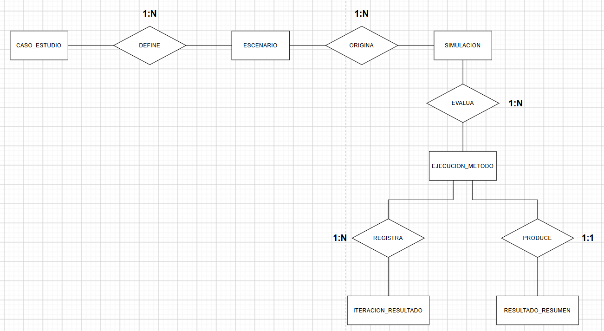

# 🚡 SIMTELE-RISK — Plataforma Integrada de Simulación Numérica

**SIMTELE-RISK** es un sistema web interactivo de simulación y análisis de riesgo aplicado a un sistema de transporte por teleférico urbano. La plataforma implementa métodos numéricos desarrollados desde cero (sin depender de librerías automatizadas de cálculo numérico) para resolver problemas físicos de frenado de emergencia, deterioro mecánico, oscilaciones por viento y reconstrucción de telemetría de sensores.

---

## 📅 Evolución del Proyecto: Semana 1 vs. Semana 2

### 🔹 Semana 1: Fundamentos, Arquitectura y Prototipo Inicial
Durante la **Semana 1** se establecieron las bases conceptuales, la organización del equipo y el prototipo estático inicial:
- **Reparto Estricto de Roles:**
  - **Integrante 1 (Rol C):** Solvers y algoritmos de búsqueda de raíces.
  - **Integrante 2 (Rol D):** EDOs e integración numérica.
  - **Integrante 3 (Rol B):** Polinomios de interpolación y reconstrucción de señales.
  - **Integrante 4 (Rol A):** Arquitectura de software, modelo de datos y diseño web.
- **Definición de los 4 Módulos Obligatorios:** 
  1. Detención de emergencia ($v(t) = 0$).
  2. Cruce de umbral de desgaste de cable ($D(t) - D_{umbral} = 0$).
  3. Oscilaciones por viento (EDO + Integración).
  4. Reconstrucción de telemetría de sensores (Interpolación).
- **Marco Transversal de Teoría de Errores:** Formulación teórica de métricas de error absoluto, relativo, porcentual y residuo normado.
- **Prototipo Base:** Estructura inicial del frontend en Bootstrap y especificación del informe escrito inicial.

---

### 🚀 Semana 2: Integración Total, SQLite Relacional y Multiescenarios
En la **Semana 2** se ejecutó la **integración técnica completa** y la **persistencia de datos** liderada por el **Integrante 4**:
- **Base de Datos Relacional SQLite (`database/simtele.db`):** 
  - Diseño e implementación de un esquema normalizado de **6 tablas relacionales**: `caso_estudio`, `escenario`, `simulacion`, `ejecucion_metodo`, `iteracion_resultado` y `resultado_resumen`.
  - Configuración de claves foráneas (`FOREIGN KEYS`) e inserción automática de datos semilla.
- **API RESTful Backend en Flask (`backend/app.py`):**
  - Construcción de endpoints JSON para ejecutar simulaciones en vivo y persistir automáticamente cada corrida en la base de datos.
  - Creación del endpoint `/api/historial` para recuperar experimentos guardados.
- **Conexión de Algoritmos Numéricos de los 4 Integrantes:**
  - `backend/raices.py` (Módulos 1 y 2: Bisección, Newton-Raphson, Secante).
  - `backend/modulo3.py` (Módulo 3: Runge-Kutta 2/4, Trapecio, Simpson, Romberg).
  - `backend/interpolacion.py` (Módulo 4: Interpolación de Lagrange y Newton).
  - `backend/metrics.py` (Cálculo de matrices de error y residuos).
- **Frontend Interactivo Multiescenario (`frontend/index.html`):**
  - Incorporación de selectores desplegables `<select>` por tarjeta para cambiar de escenario (*NORMAL*, *ESTRÉS*, *MAL_CONDICIONADO*) en tiempo real.
  - Visualización gráfica dinámica de curvas con **Chart.js**.
  - Tabla de historial de simulaciones conectada a SQLite con actualización en vivo.

---

## 🏗️ Arquitectura del Sistema (3 Capas)

El proyecto sigue una arquitectura limpia dividida en 3 capas (Presentación, API/Lógica y Persistencia):


\##  Estructura del Repositorio


```text

simtele-risk/

├── backend/            # Servidor web, APIs y algoritmos numéricos

│   ├── app.py

│   ├── database.py

│   └── models/

├── frontend/           # Interfaz de usuario

│   ├── index.html      # Pantalla principal del prototipo

│   ├── static/         # Estilos CSS y Scripts JS

│   └── templates/      # Vistas HTML

├── database/           # Archivos de persistencia y esquemas

│   ├── schema.sql      # Script de creación de tablas SQL

│   ├── der.png         # Diagrama Entidad-Relación

│   └── simtele.db      # Base de datos SQLite

├── docs/               # Informes y documentación del proyecto

│   └── .gitkeep

└── README.md           # Presentación principal del repositorio
```





## 🗄️ Modelo Relacional de Base de Datos (6 Tablas)

La base de datos SQLite gestiona la información de los experimentos mediante 6 tablas relacionales:

1. **`caso_estudio`**: Almacena los 4 módulos temáticos del sistema teleférico.
2. **`escenario`**: Registra los entornos de prueba (*NORMAL*, *ESTRÉS*, *MAL_CONDICIONADO*).
3. **`simulacion`**: Registro maestro de cada corrida (fecha/hora, usuario/equipo, estado de ejecución).
4. **`ejecucion_metodo`**: Métodos numéricos aplicados (tolerancia, tiempo en ms, convergencia).
5. **`iteracion_resultado`**: Detalle iteración por iteración (valor aproximado, residuo, error absoluto y relativo).
6. **`resultado_resumen`**: Métricas globales y resúmenes de salida en formato JSON.

---

## 🛠️ Requisitos e Instalación

### Prerrequisitos
- Python 3.10 o superior
- Terminal Git Bash / Consola de comandos

### 1. Clonar el repositorio
```bash
git clone [suspicious link removed]
cd simtele-risk