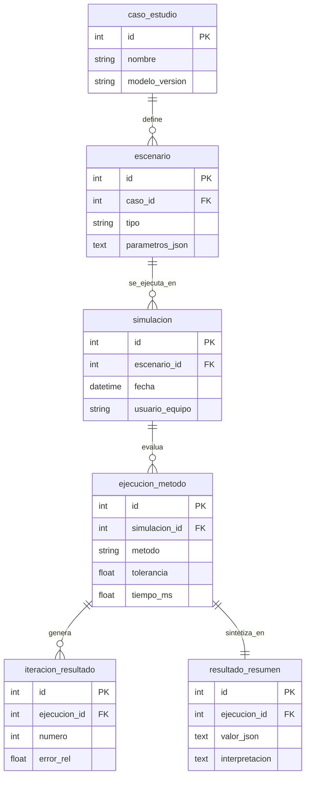

\#  SIMTELE-RISK: Sistema Integrado de Simulación y Métodos Numéricos


\*\*SIMTELE-RISK\*\* es una aplicación web interactiva diseñada para la simulación, evaluación y análisis numérico de un sistema de transporte por cable (inspirado en el sistema \*Mi Teleférico\* de La Paz). La plataforma permite ejecutar y analizar cuatro módulos de casos de estudio bajo tres escenarios operativos, aplicando teoría de errores transversal y comparando la eficiencia y estabilidad de diversos métodos numéricos.


\---


\##  Módulos y Casos de Estudio


La plataforma cuenta con 4 módulos obligatorios:

1\. \*\*Detención de Emergencia:\*\* Evaluación de tiempo y distancia de frenado de cabinas ante variaciones de velocidad y reacción.

2\. \*\*Deterioro Mecánico y Mantenimiento:\*\* Calibración de coeficientes y estimación del tiempo hasta alcanzar un umbral de inspección.

3\. \*\*Oscilaciones por Viento:\*\* Simulación del comportamiento de cabinas ante fuerzas dinámicas externas de viento.

4\. \*\*Reconstrucción de Sensores:\*\* Interpolación y reconstrucción de señales continuas a partir de datos con fallas o ruido.


\---


\##  Escenarios de Evaluación


Cada módulo permite ejecutar simulaciones en tres condiciones experimentales:

\* \*\*NORMAL:\*\* Parámetros nominales sintéticos y datos en condiciones ideales de cálculo.

\* \*\*ESTRÉS:\*\* Exigencias operativas elevadas (mayor paso, perturbaciones severas o rangos extensos).

\* \*\*MAL CONDICIONADO:\*\* Pruebas numéricas con alta sensibilidad matemática (matrices de alto número de condición \\\\(\\kappa(A)\\\\), datos de interpolación desfavorables o raíces múltiples).


\---


\##  Arquitectura y Tecnologías


\* \*\*Backend:\*\* Python (Flask / FastAPI)

\* \*\*Frontend:\*\* HTML5, CSS3, Bootstrap 5, Chart.js (gráficos), MathJax (renderizado de ecuaciones).

\* \*\*Base de Datos:\*\* SQLite (persistencia de simulaciones e iteraciones).


\---


\##  Estructura del Repositorio


```text

simtele-risk/

├── backend/            # Servidor web, APIs y algoritmos numéricos

│   ├── app.py

│   ├── database.py

│   └── models/

├── frontend/           # Interfaz de usuario

│   ├── index.html      # Pantalla principal del prototipo

│   ├── static/         # Estilos CSS y Scripts JS

│   └── templates/      # Vistas HTML

├── database/           # Archivos de persistencia y esquemas

│   ├── schema.sql      # Script de creación de tablas SQL

│   ├── der.png         # Diagrama Entidad-Relación

│   └── simtele.db      # Base de datos SQLite

├── docs/               # Informes y documentación del proyecto

│   └── .gitkeep

└── README.md           # Presentación principal del repositorio


## Modelo Entidad Relación (DER)

